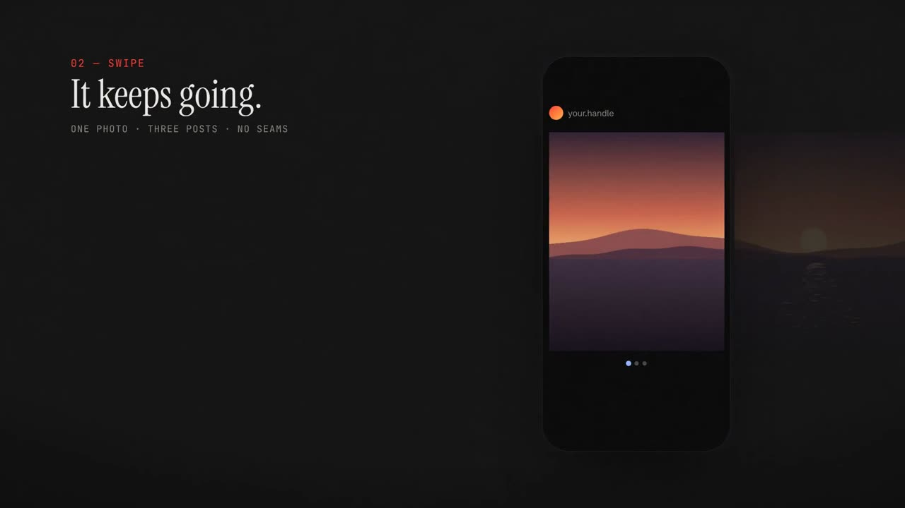

# CLLGE

**Seamless Instagram carousels with photos _and_ video. Free, open source, and everything happens on your device.**

[](docs/media/how-it-works.mp4)

Design one long horizontal canvas, drop in a panorama, a clip and some text, and CLLGE cuts it into
carousel pages that line up exactly when people swipe. Pages with a moving clip become MP4 files (with
sound); the rest become photos. No account, no watermark, no upload, up to 20 pages.

> Status: early (v0.6.1). Tested in desktop Chromium; real iPhone/Android checks are still pending —
> please report what works on your phone.

### v0.6.1

- **iPhone clips (.MOV) now show up.** Safari on iOS loads no frames for a video that is not playing, so
  clips appeared as grey boxes. Frames are now decoded on the device with WebCodecs whenever the browser
  has none to show (editor, live phone, filmstrip, Auto collage, Preview), and the Preview plays muted
  until you tap the sound button, as iOS requires.

### New in v0.6 — making it is the fun part

- **Auto collage.** Pick 3–30 photos or clips and CLLGE lays out the whole carousel in your order: a cover,
  spreads, a photo *across a seam* (cut at a third, so a centred subject stays whole), a panorama for very
  wide shots, a closing slide. Four styles (Editorial, Clean grid, Film roll, Scrapbook), **Another idea**
  for a new layout, and a lock on any slide you want to keep. Everything it makes stays editable; Undo
  brings your previous layout back. From the home page, the editor or the panorama flow.
- **Bridges between slides.** Tap the chip on any seam: tape over the cut, a photo across it, words that
  continue on the next slide, an arrow, a "swipe →" tag, or one **continuous pen line through every slide**.
  Or pick **Draw** and draw your own lines across the seams (marker, pencil, dashed, scribble).
- **Live phone + seam guard.** A small phone shows the slide in view exactly as it will post while you edit
  (swipe it to move around). CLLGE warns you when a cut falls on what matters: a point you marked on a photo
  (double-tap it in crop mode, or **Find a face** where the browser can do it on device), words split in two
  by a seam, or a sliver of a photo on the next slide. **Nudge** moves the layer just clear of the seam.
- **Stickers & doodles** drawn by code (sharp at any size): loop and swoosh arrows, a marker circle,
  underline, star, sparkle, heart, asterisk, squiggle, X, bracket, a "NEW" burst, a ticket, a date stamp,
  a swipe tag and tape. They take colours from a palette sampled from your own photos.
- **Frames & masks** for photos and clips: instant-photo with a handwritten caption, 35 mm film with
  sprockets, a perforated stamp, taped corners, a print shadow; masks in circle, arch, blob, torn paper,
  perforated edge and ticket shapes.
- **Text effects and 21 fonts** in four families: editorial serifs (Fraunces, Bodoni Moda, Gloock, Young
  Serif, Italiana, Instrument Serif), bold display (Bricolage Grotesque, Syne, Unbounded, Climate Crisis,
  Rubik Mono One, Schibsted Grotesk), handwritten (Permanent Marker, Reenie Beanie, Homemade Apple, Caveat)
  and typewriter & retro (Special Elite, Space Mono, Major Mono Display, Monoton, JetBrains Mono).
  One-tap styles: Masthead, Marker note, Dymo label, Typewriter, Neon, Rubber stamp, Outline, Curved,
  **Ransom** (each letter cut from a different font) and Across the seam. Plus letter spacing, curve,
  stroke, glow, marker/box/label highlights.
- **A phone editor.** Under 760 px the editor becomes one slide at a time with swipe-to-snap between slides,
  a bottom dock (Add · Edit · Slides · Preview) and a sheet you drag between three heights. Pinch and
  rotate a selected layer with two fingers, and long-press a layer for its menu. The home page and the
  panorama flow were also adjusted for 375–430 px screens.

### v0.5 — cyanotypes

- **A cyanotype world.** The home page and the templates now use a series of cyanotype prints (Prussian
  blue on cotton paper, one hand-painted red accent each), generated with GPT Image 2 from
  [prompts written for this project](docs/art/PROMPTS.md). The home panorama is four panels joined into one
  horizon — sunset, lighthouse, hillside town, night — and each red accent glows as you pass it.
- The cover print *rinses* from olive-bronze to blue as you scroll; the clip in the seam is a real dive,
  frame by frame; sample photograms hang on the drying line; the page closes on three prints on the bench.
- Link previews: a 1200×630 share card with the title.
- Decorations (tape, stamp, postmark, film strip, string, torn paper) are still drawn by code. Missing images
  fall back to code-drawn art.

### v0.4

- **A home page in three acts.** *Developing*: the cover photo develops in a WebGL tray as you scroll, and
  your cursor ripples the liquid. *One endless panorama*: scrolling moves one continuous world sideways
  across five slides, with a phone that shows it as a carousel, a clip in a seam and the export. *Film roll*:
  the templates are frames on a negative that turn positive as they reach you. Saved projects hang on a
  drying line that sways with your scroll.
- Entrance transitions into templates, the panorama flow and the editor. Falls back gracefully without
  WebGL or with *reduce motion*.

### v0.3

- **Demo film** (28 s, with subtle synthesized sound) made entirely in code with Remotion — source in
  [`video/`](video/).

### v0.2

- **Split a panorama** — pick a wide photo; the app suggests how many slides it fills, shows the exact
  cut lines, lets you drag the frame, add a cover/closing slide, and swipe a phone preview before exporting.
- **Eight original templates** in four families — *Horizon line*, *Postcard* (panorama); *Window seat*,
  *Doorway* (a clip that stands in the seam); *Contact sheet*, *Drying line* (film); *Issue 01*, *Field notes*
  (magazine & scrapbook). Sample images are cyanotypes generated with GPT Image 2 (since v0.5); every slot
  falls back to code-drawn art if an image is missing.
  Tap **+ Photo / + Clip** on a slot, or **Fill** to drop several photos into the slots in order.
- **"Darkroom" design** — near-black workspace, one safelight-red accent, serif display type, spring
  animations (respecting *reduce motion*), page filmstrip, phone-frame previews. Fonts are bundled (OFL).

## What it does

| | |
|---|---|
| **One canvas, many pages** | Pages are windows onto a shared world (`[i·W, (i+1)·W)`), so a photo is placed and cropped **once** and continues across seams with no jumps or repeated columns. |
| **Mixed export** | Each page becomes `01.jpg`, `02.mp4`, `03.jpg`… A page becomes MP4 when a visible clip reaches it or it has audio; the whole collage (background, photos, text) is rendered into the video. |
| **Video & audio rules** | Trim (in/out), start time, volume, "hold last frame". Page length = the longest clip on it. Clips are sampled by timestamp, so phone clips with variable frame rate stay in sync. One audio track per page (auto, silent or a chosen clip). |
| **Honest compatibility** | Before you build a montage, the app tells you whether this browser can decode your clip, encode H.264 and encode AAC. If it can't, it says so and offers a choice (silent videos, photos only) instead of silently dropping motion. |
| **Templates & slots** | Slots keep their frame (position, rotation, corners) when you drop your own photo or clip in; a photo slot accepts a clip and becomes video. Export warns if sample art is left. |
| **Editing** | Move, resize, rotate, snap to seams/centres, layers (order, lock, hide), photo crop inside its frame (double-click), text with effects, stickers, pen lines, frames and masks, undo/redo, keyboard nudges (1 px / Shift 10 px). |
| **Auto collage** | A deterministic layout engine (`src/autolayout/compose.ts`) scores page recipes by how well each photo's shape fits its slot, keeps your order and the rhythm (no two identical spreads in a row), and respects locked slides. |
| **Seam guard** | `src/model/seams.ts` checks points of interest, text lines and slivers against every seam and computes the smallest nudge that clears them. |
| **Preview** | Swipe preview with per-page clocks like the feed, and a "seams at 100 %" view showing two neighbouring pages at the same instant. |
| **Saving** | Autosave to the browser's IndexedDB (media first, then the revision); detects edits from another tab instead of overwriting. |
| **Delivery** | Share sheet on phones (when the browser supports sharing files), per-file download, or ZIP — plus the steps to post them in order. |

## Use it

Once GitHub Pages is enabled for this repo the app is served at `https://<owner>.github.io/CLLGE/`.
To run it locally:

```bash
npm install
npm run dev
```

Then open the printed URL (it ends in `/CLLGE/`).

### Posting to Instagram

1. Export and save the files (Share → Save to Photos, or download and unzip).
2. Instagram → Create post → **Select multiple** → pick `01`, `02`, `03`… **in order**.
3. Keep the original crop (4:5 or 1:1) and check that video pages move and play sound in the preview.

## Browser support

MP4 export needs [WebCodecs](https://developer.mozilla.org/en-US/docs/Web/API/WebCodecs_API) H.264
encoding: current Chrome/Edge (desktop and Android) and Safari 17+ (still to be verified on a device).
Photos export everywhere. Where AAC audio encoding is missing (e.g. Chromium on Linux), audio is written
as Opus inside MP4 and the app warns you, because some apps may not accept it. HEIC photos and HEVC/HDR
clips depend on the browser; unsupported files are reported by name when you import them.

## Privacy

There is no server. Photos and videos are read, rendered and encoded in your browser and stored in its
local storage until you delete the project. Clearing the site's data deletes your projects.

## Develop

```bash
npm run typecheck   # TypeScript
npm test            # unit tests (model, geometry, timing, page planner, history)
npm run e2e         # Playwright: exact seams on 3 and 20 pages, the mixed JPG–MP4–JPG export, the editor flow
npm run build       # static build in dist/
```

```
src/
  model/        document schema v1, geometry, clip timing, page planner, undo history
  render/       drawRegion(): the one drawing function shared by editor, preview and export
  media/        import (EXIF orientation, probing clips), runtime pixel sources
  export/       stills, MP4 per page (Mediabunny + WebCodecs), audio, ZIP
  capabilities/ what this device can decode/encode/share
  storage/      IndexedDB persistence
  editor/       React UI
tests/          unit, e2e, synthetic fixtures (FFmpeg test patterns and a 440 Hz tone)
```

The product and engineering background is in [`docs/`](docs/), including the
[research notes on SCRL's web client](docs/research/scrl-web-findings.md).

## En español

CLLGE es un editor gratuito y de código abierto para crear carruseles continuos con fotos y vídeo.
Todo se procesa en tu dispositivo: sin cuenta, sin marca de agua y sin subir tus archivos. Exporta
cada página como foto o como MP4 con sonido, en el orden correcto para Instagram. La interfaz está en
inglés.

Desde la v0.6 incluye:

- **Auto-collage:** maqueta todo el carrusel a partir de tus fotos, en cuatro estilos, y puedes bloquear las
  diapositivas que te gusten.
- **Puentes entre diapositivas:** cinta, foto, texto, flecha o una línea continua que cruzan la costura.
- **Móvil en vivo y aviso de costura:** ves cada diapositiva tal como se publicará, y la app te avisa (y lo
  corrige con «Nudge») cuando un corte cae sobre algo importante.
- **Pegatinas, garabatos, marcos, máscaras, efectos de texto y 21 fuentes.**
- **Editor rediseñado para el móvil.**

## License

[MIT](LICENSE). Not affiliated with SCRL, Appostrophe AB or Instagram/Meta.
